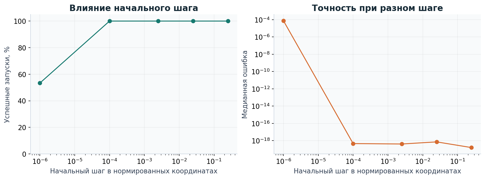

# Задания для самостоятельной работы

Соколов Никита Константинович, группа К3339, поток 1.2, вариант 7.

## 1. Ручные примеры из методички

Расчёты повторены и проверены численно. Здесь приведены результаты первых примеров всех 15 разделов. Это учебные вычисления, они не добавляют другие методы в оптимизатор варианта 7.

| Раздел | Расчёт и результат |
| --- | --- |
| Генетический алгоритм | Для точек 5, 12, 3, 9 значения функции равны 36, 1, 64, 4. Вероятности рулетки приблизительно 0.036, 0.673, 0.021, 0.269. Одноточечное скрещивание даёт 1101 и 1000, равномерное 1001. Мутация третьего бита даёт 1011, то есть 11 и значение 0. Арифметический потомок равен `(2.5, 1.25)`, интервалы BLX равны `[0.4, 3.6]` и `[0.7, 2.3]`. |
| Отжиг | При ухудшении на 1 вероятности принятия для температур 10, 1, 0.1 равны 0.904837, 0.367879, 0.0000454. При ухудшении на 5 получаются 0.606531, 0.006738 и 1.92875e-22. Использована формула `exp(-delta / T)`. |
| Поиск с запретами | При памяти длины 3 путь идёт последовательно от 0 до 10. Лучшее посещённое состояние равно 9, значение функции равно 0. В точке 1 разрешён переход к худшей точке 2, а возврат к 0 запрещён. Обычный спуск остановился бы в точке 1. |
| Муравьиный алгоритм | Ненормированные веса равны 0.25, 0.125, 0.04. После деления на сумму получаются 0.602410, 0.301205, 0.096386. Новый феромон ребра AB равен `0.5 + 10 / 12 = 1.333333`. В непрерывном варианте первые пять рангов получают около 88% общей вероятности. |
| ABC | Первая координата кандидата равна `1 - 0.5 × (1 - 3) = 2`, вторая остаётся 2. Вероятности наблюдателей приблизительно 0.216, 0.108, 0.029, 0.647. Для отрицательного значения применяется соответствующая ветвь формулы приспособленности. |
| Bees Algorithm | Стоимость итерации равна `2 × 10 + 3 × 4 + 15 = 47`. С учётом 20 начальных вычислений помещаются 212 полных итераций. |
| Рой частиц | Вклады инерции, личного и общего лидера равны `(0.35, -0.35)`, `(-0.3, 0)` и `(-1.8, -0.3)`. Новая скорость равна `(-1.75, -0.65)`, новая позиция `(0.25, 0.35)`. |
| Дифференциальная эволюция | Мутант равен `(1.5, 0)`. С принудительным выбором второй координаты первый потомок равен `(1.5, 0)`, с принудительным выбором первой координаты второй потомок равен `(1.5, 0.5)`. |
| Полёты Леви | Для показателя 1.5 масштаб равен 0.6965745. При 100 000 шагах и зерне 27 доля модулей больше 3 равна 7.48% для Леви и 0.262% для нормального распределения. Перцентили 99 равны 10.9958 и 2.5952. Небольшое отличие от таблицы методички объясняется другой случайной выборкой. |
| Островная модель | Три острова по 30 особей требуют 90 вычислений на оценку поколения. Помещаются 111 таких оценок, включая начальную, то есть 110 обновлений и 11 миграций. |
| Нелдер и Мид | Значения в начальных вершинах равны 3, 6, 9. Центр лучших равен `(1.5, 1)`. Отражение даёт `(2, 0)` со значением 4 и принимается. Растяжение дало бы 8.25, внешнее сжатие 3.5625. |
| Пиявский | Первые шесть точек равны 5.1028, 6.0769, 4.1288, 3.4763, 4.7812, 5.3673. Первая нижняя оценка приблизительно -13.577, лучший результат до первого шага 0.8056. Использована константа Липшица 6. |
| Множители Лагранжа | Условия `2x + lambda = 0`, `2y + lambda = 0`, `x + y = 1` дают `x = y = 0.5`, `lambda = -1`, значение 0.5. |
| Декомпозиция | Значения одномерной функции на узлах от -5 до 5 равны 100, -10, -39, -29, -10, 0, -5, -19, -24, 10, 125. Лучший узел равен -3. Полная сетка требует 121 вычисление, две одномерные сетки 22. |
| Численный градиент | Центральные разности с шагом `1e-6` в точке `(-1.2, 1)` дают градиент Розенброка `(-215.6, -88.0)`, совпадающий с аналитическим с точностью `1e-6`. |

Геометрическое охлаждение с начальной температурой 10 и множителем 0.95 даёт 5.987369 после 10 шагов и 0.769450 после 50. Логарифмическое охлаждение даёт 4.170324 после 10 шагов и 1.447439 после 1000.

## 2. Компоненты по отдельности

Для гибрида, отжига и поиска с запретами выполнено по 30 запусков с одинаковыми зёрнами и лимитом 10 000 вычислений. Таблица и вывод находятся в разделе 7 [основного отчёта](README.md). Нельзя считать дополнительные цифры точности ниже турнирного порога гарантированным преимуществом в битве.

## 3. Чувствительность параметра

Исследован начальный шаг поиска с запретами. Остальные параметры одинаковы, зёрна от 1 до 30, функция Леви N.13. Результаты сохранены в разделе `step_sensitivity` файла [измерений](results/benchmark.json).

| Начальный шаг | Доля успехов | Медиана f | Среднее NFE |
| --- | --- | --- | --- |
| 0.000001 | 53.33% | 7.40668e-5 | 9945.2 |
| 0.0001 | 100% | 4.56940e-19 | 8947.2 |
| 0.0025 | 100% | 4.07505e-19 | 9038.7 |
| 0.025 | 100% | 7.15268e-19 | 9123.1 |
| 0.25 | 100% | 1.57236e-19 | 9225.2 |

Слишком маленький шаг не позволяет пройти даже оставшееся расстояние внутри найденной области за доступный бюджет. При шаге 0.025 получается стабильный результат без максимальной стоимости крупного шага. Это рабочий компромисс, а не доказательство единственного оптимального параметра. В проверенном диапазоне радиуса запрета от 0.003 до 0.1 доля успехов оставалась 100%, поэтому для подробного исследования выбран более чувствительный начальный шаг.

Воспроизведение: `python3 benchmark.py --study`, затем `python3 demo.py --results results/benchmark.json`.

## 4. Условия применения

Отжигу нужны вычислимая функция и возможность строить соседние точки. Гладкость и производные не используются. Принятие ухудшений позволяет пересекать барьеры, но геометрическое охлаждение с ограниченным бюджетом не даёт гарантии глобального минимума.

Поиску с запретами нужны окрестность, память посещений и критерий стремления. Он также не требует производных. Уменьшение шага лучше работает на непрерывных функциях, где близкие точки позволяют постепенно уточнять решение. Слишком большая запретная область ограничивает исследование, слишком короткая память позволяет повторять прежний путь.

Функция Леви N.13 непрерывна и гладкая на заданном прямоугольнике. Её смешанные зависимости не позволяют независимо минимизировать обе координаты. Выбранные компоненты не предполагают сепарабельности и подходят к этому рельефу. В обоих методах все вычисления учитываются в одном бюджете.

## Вопросы для защиты

1. Отжиг исследует область за счёт вероятностного принятия ухудшений. Поиск с запретами уточняет решение и использует память. Переключения отмечены на графике сходимости.
2. После начальной выборки резервируется 16% оставшегося бюджета. Остаток делится на восемь циклов, внутри цикла 55% после выбора старта получает отжиг. Свободный остаток используется дальше.
3. При минимуме на границе отражение сохраняет предложения отжига внутри области, а проекция позволяет локальному этапу попасть точно на границу. Это проверено отдельным тестом.
4. Производные и сепарабельность не нужны. Конечный бюджет и эмпирические настройки ограничивают надёжность независимо от гладкости функции.
5. Случайны старты, предложения отжига и часть направлений соседства. Одно зерно определяет весь генератор и воспроизводит историю, но не время исполнения.
6. На простой функции гибрид может тратить время на лишние перезапуски. На узких впадинах может не найти нужную область, а на дорогой функции стоимость тысяч вычислений станет основной. Поэтому сравниваются точность, надёжность и время, а не только лучший отдельный запуск.
