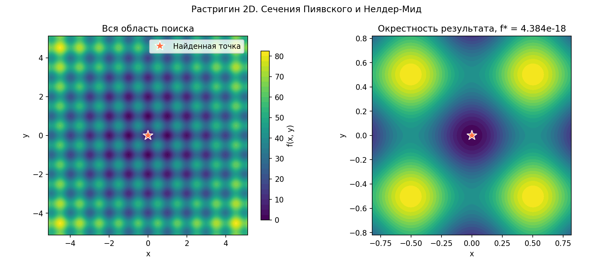

# Лабораторная работа 5

Битва методов оптимизации. Соколов Никита Константинович, группа К3339, поток 1.2.

Гибрид сочетает сечения методом ломаных Пиявского и локальный поиск Нелдера-Мида. Резервные направления повышают устойчивость на повёрнутых многоэкстремальных функциях. Готовых солверов оптимизации нет.

## Запуск

Откройте папку `lab5`. Один раз установите зависимости для рисунка:

```sh
python3 -m pip install -r requirements.txt
```

Обычный запуск:

```sh
python3 hybrid_optimize.py
```

Программа выводит `x*`, `y*`, `f*`, время поиска в секундах, число реальных вызовов функции и статус. Контуры и найденная точка сохраняются в `demo_rastrigin2d.png`. Графический интерфейс не нужен. Импорт библиотек и построение рисунка не входят во время поиска и число вызовов в отчёте.



## Проверки

```sh
python3 -m unittest -v test_hybrid_optimize.py
python3 hybrid_optimize.py --bounds -4.8 5.3 -5.0 5.1 --no-plot
python3 hybrid_optimize.py --no-target --no-plot
python3 benchmark.py --baseline --repeats 11
```

Сравнение с исходной реализацией читает коммит `44fb275` из истории Git. В архиве без истории запустите `python3 benchmark.py` для сравнения трёх новых вариантов. Подробные результаты находятся в [BENCHMARK.md](BENCHMARK.md), описание метода и критерий битвы в [REPORT.md](REPORT.md).

## Другая функция на защите

Передайте свою функцию двух аргументов и границы в `hybrid_optimize`. Функция должна быть детерминированной и возвращать конечные значения во всей области.

```python
from hybrid_optimize import hybrid_optimize, battle_print

def objective(x, y):
    return (x - 1.3) ** 2 + 2 * (y + 0.7) ** 2 - 5

result = hybrid_optimize(objective, bounds=(-4, 4, -4, 4))
battle_print(result)
```

Не задавайте `lower_bound`, если достоверная нижняя граница неизвестна. Для Растригина она явно равна нулю. Параметры `grid`, `top_k`, `angles` и `line_budget` увеличивают охват поиска ценой дополнительных вычислений. Одинаковый `seed` воспроизводит результат, но не время запуска.
