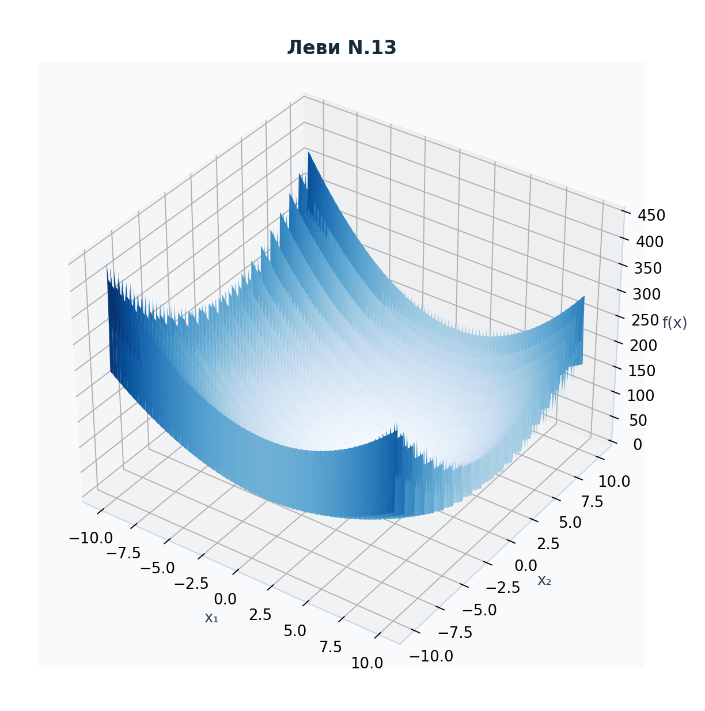
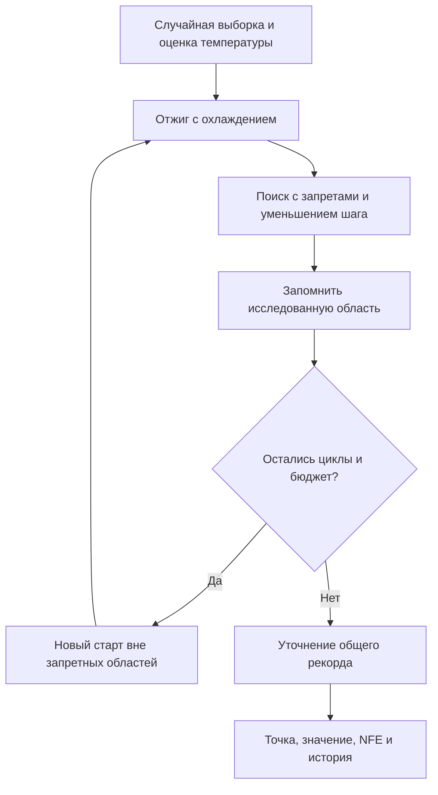
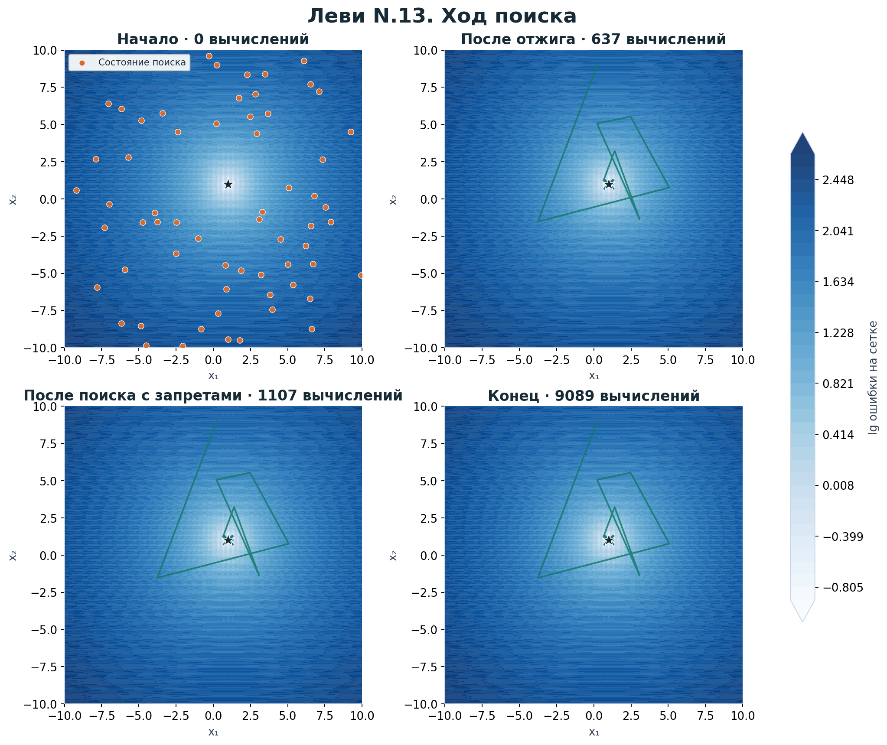
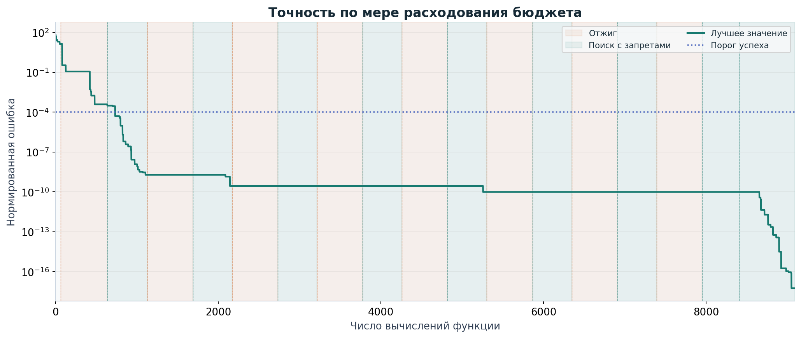
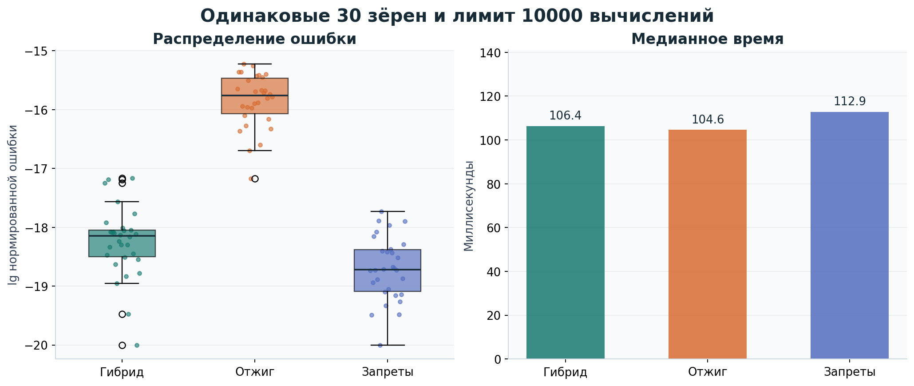

# Битва методов оптимизации

Имитация отжига и поиск с запретами. Вариант 7.

| Сведения | Значение |
| --- | --- |
| Студент | Соколов Никита Константинович |
| Группа | К3339 |
| Поток | 1.2 |
| Преподаватель | Лаврентьев С. |
| Номер в списке | 27 |
| Вариант | Остаток от деления 27 на 20 равен 7 |
| Тестовая функция | Леви N.13 |
| Реализация | [optimizer.py](optimizer.py) |

## 1. Тестовая функция

$$
f(x,y)=\sin^2(3\pi x)+(x-1)^2\bigl(1+\sin^2(3\pi y)\bigr)+(y-1)^2\bigl(1+\sin^2(2\pi y)\bigr).
$$

Область поиска: `[-10, 10] × [-10, 10]`. Глобальный минимум равен нулю в точке `(1, 1)`. Осцилляции создают много локальных минимумов. Известный ответ используется исключительно для оценки результатов, оптимизатор его не получает.



## 2. Идея комбинации

Используется последовательная схема с повторными запусками. Начальная случайная выборка задаёт старт и масштаб температуры. Отжиг принимает улучшения и иногда ухудшения по критерию Метрополиса, поэтому может выйти из локального минимума. Затем поиск с запретами выбирает лучшего разрешённого соседа, даже когда тот хуже текущей точки. Память мешает немедленному возврату, но улучшение рекорда разрешает нарушить запрет. Окрестности исследованных кандидатов также исключаются из следующих этапов отжига до истечения срока памяти. После двух неудачных итераций локальный шаг уменьшается вдвое. Направление предыдущих улучшений помогает двигаться по узким долинам. Последний этап уточняет общий рекорд.

Оба компонента не требуют производных и сепарабельности. Непрерывность полезна для локального уточнения. Конечный бюджет не гарантирует глобального минимума произвольной функции.

## 3. Схема алгоритма



## 4. Параметры

| Параметр | Значение | Обоснование |
| --- | --- | --- |
| `initial_points` | 64 | Старт и оценка масштаба значений |
| `cycles` | 8 | Несколько попыток при ограниченном бюджете |
| `annealing_share` | 0.55 | Доля отжига внутри цикла после выбора старта |
| `final_share` | 0.16 | Резерв остатка бюджета после начальной выборки |
| `temperature_ratio` | 0.05 | Температура относительно межквартильного размаха функции |
| `cooling_ratio` | 1e-7 | Отношение конечной температуры к начальной |
| `tabu_tenure` | 12 | Число последних позиций в памяти |
| `basin_tenure` | 4 | Число исследованных областей в памяти |
| `tabu_radius` | 0.012 | Радиус запрета в единичном квадрате |
| `local_step` | 0.025 | Начальный размер локальной окрестности |
| `minimum_step` | 5e-11 | Остановка локального уточнения по шагу |

Окрестность содержит восемь направлений, после первого улучшения добавляются два направления по накопленному перемещению. Радиус кратковременного запрета равен 0.3 текущего шага. Следующий старт выбирается из 24 новых точек. Неизрасходованный бюджет перераспределяется между оставшимися циклами и финальным уточнением. Параметры зафиксированы в `DEFAULTS` и не меняются под конкретную функцию.

## 5. Особенности реализации

Координаты нормируются к единичному квадрату. В отжиге границы обрабатываются отражением, в поиске с запретами проекцией. Каждый вызов функции проходит через `Budget.eval`, включая повторные точки. Лимит проверяется до вызова. Остановка происходит по бюджету либо после завершения циклов и уменьшения финального шага ниже порога.

Интерфейс соответствует шаблону: `optimize(f, bounds, max_nfe=10000, seed=None, constraints=None, **params)`. Все случайные числа получены из `np.random.default_rng(seed)`. Возвращаются точка, значение, NFE, история, переключения, снимки и траектория рекорда. Внутри метода нет печати, рисования, готовых солверов и обращений к известному минимуму.

Вариант 7 имеет только прямоугольные границы. Дополнительные ограничения отклоняются явно. Шум, узкие впадины и дорогая функция могут ухудшить результат. На Eggholder и Букине были неуспешные запуски, поэтому универсальная победа не гарантируется.

Эталонный `functions.py` сохранён дословно, включая исходные комментарии, по требованию задания. Собственный код написан без комментариев и docstrings.

## 6. Результаты на своей функции

Фактический запуск `python3 run.py --func levy13 --seed 1`:

```text
x* = (1.00000000024, 1.00000000085)
f(x*) = 5.69193955046e-18
NFE = 9089
время = 0.133816 с
успех
```

Серия на зёрнах от 1 до 30, лимит 10 000 вычислений:

| Лучшее f | Медиана f | Худшее f | Доля успехов | Среднее время, с | Среднее NFE |
| --- | --- | --- | --- | --- | --- |
| 4.22310e-22 | 7.15268e-19 | 6.82230e-18 | 100% | 0.115605 | 9123.1 |

Среда: macOS 26.6.2, arm64, Python 3.9.6, NumPy 2.0.2. Перед каждой конфигурацией выполнен прогрев. Измерения последовательные, порядок компонентов перемешивается. Внешний счётчик проверяет границы и бюджет, таймер охватывает весь вызов оптимизатора. Независимый пересчёт результата, импорт библиотек и графика находятся вне замера. Время зависит от загрузки компьютера.



Показаны начальная выборка и состояния поиска в четырёх моментах. Линия соединяет улучшения рекорда, звезда обозначает известный минимум. Это метод одной текущей точки, а не популяционный алгоритм.



Фон показывает смену методов, вертикальные линии отмечают переключения. Для зерна 1 порог успеха впервые достигнут на 733 вычислении. Продолжение поиска проверяет другие области и уточняет результат.

## 7. Сравнение с компонентами

Каждый метод получает одинаковые зёрна и лимит 10 000 вычислений. Компоненты запускаются самостоятельно. У отжига есть собственное финальное охлаждение. У поиска с запретами сохраняются повторные старты и изменение шага.

| Метод | Успех | Медиана f | Медиана lg e | Среднее время, с | Среднее NFE |
| --- | --- | --- | --- | --- | --- |
| Гибрид | 100% | 7.15268e-19 | -12 | 0.115605 | 9123.1 |
| Отжиг | 100% | 1.74480e-16 | -12 | 0.110563 | 10000.0 |
| Поиск с запретами | 100% | 1.91012e-19 | -12 | 0.116646 | 8784.9 |



Все три метода проходят порог, турнирная оценка точности одинакова. Гибрид точнее отжига, но отдельный поиск с запретами даёт ещё меньшую медианную ошибку. Ускорение относительно обоих компонентов на этой функции не подтверждено. Комбинация объединяет исследование области и уточнение, но безусловное превосходство по этой таблице утверждать нельзя.

Нормированная ошибка: `(f(x*) - f_opt) / max(1, abs(f_opt))`. Успех соответствует ошибке не больше `1e-4`. Турнирная точность: `median(log10(max(e, 1e-12)))`, устойчивость: межквартильный размах этих логарифмов. Веса рангов из задания: 0.4 для доли успехов, 0.3 для точности, 0.1 для устойчивости и 0.2 для времени. Финальный критерий устанавливают преподаватели. На рисунке порог отображения ошибки равен `1e-20`, чтобы показать различия ниже турнирного порога.

[Исходные измерения](results/benchmark.json) содержат параметры и контрольную сумму оптимизатора. [Задания для самостоятельной работы](EXERCISES.md) содержат ручные примеры и исследование параметра.

## 8. Запуск и проверка

Открыть эту папку и выполнить:

```sh
python3 -m pip install -r requirements.txt
python3 run.py --func levy13 --seed 1
python3 run.py --func levy13 --runs 30
python3 benchmark.py --study
python3 demo.py --results results/benchmark.json
python3 -m unittest -v test_optimizer.py
```

Самостоятельное построение четырёх рисунков: `python3 demo.py --func levy13 --runs 30`. Тесты проверяют внешний бюджет, границы, воспроизводимость, скрытую функцию, сдвиги, повороты, оба компонента, запуск и неизменность эталонного файла.

На битве преподаватель импортирует `optimize` из `optimizer.py` и передаёт свою функцию. Код находится в папке `lab5` существующего репозитория. После сдачи параметры не меняются без согласования.

## 9. Источники

1. [Задание и методические указания](https://drive.google.com/drive/folders/1YWgf48aPE8CBYyMpExOGIuxi_kUhUwHP).
2. Kirkpatrick, Gelatt, Vecchi. [Optimization by Simulated Annealing](https://doi.org/10.1126/science.220.4598.671), 1983.
3. Glover. [Tabu Search, Part I](https://doi.org/10.1287/ijoc.1.3.190), 1989.

## Проверка перед сдачей

Компоненты реализованы самостоятельно. Интерфейс, внешний бюджет и вывод проверены. Серия из 30 запусков проходит. Четыре требуемых рисунка созданы. Эталонный файл не изменён. Отчёт заполнен, сравнение компонентов и задания для самостоятельной работы выполнены.
